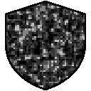
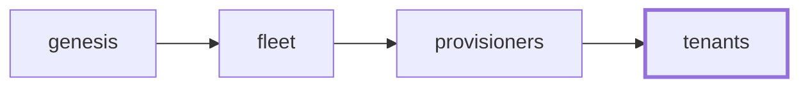
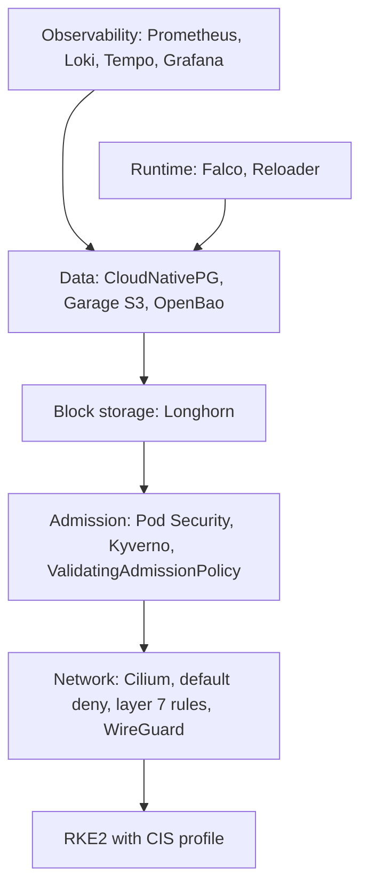

<p align="center">
  
</p>

<h1 align="center">bedrock</h1>

<p align="center">
  Production-grade Kubernetes platform for managed service providers.<br>
  One hardened cluster per tenant, nothing shared.<br><br>
  <a href="https://bedrock.sassendes.xyz"><b>Documentation</b></a>
</p>

## Why

Most platforms put many customers on one cluster and draw the lines with namespaces. Bedrock doesn't. A tenant is a full cluster with its own nodes, storage, databases, observability, policy and network edge, so one tenant's problem can never become another's. It targets regulated organisations that need to prove isolation, not promise it.

## Architecture



- **Tenant:** the workload cluster. This repository builds it today.
- **Provisioner:** stamps tenants, owns their network edge, rolls upgrades across them. Planned.
- **Fleet:** the control plane above the provisioners. Places them on providers and sites, holds the failure quorum. Planned.
- **Genesis:** the sealed starting point the rest is rebuilt from. Planned.

## The tenant cluster



| Layer | Component |
|---|---|
| Kubernetes | RKE2 with the CIS profile, secrets encryption, audit logging |
| Network | Cilium with kube-proxy replacement, layer 7 rules on every HTTP flow, WireGuard encryption between nodes, Hubble |
| Policy | Kyverno, Pod Security Admission, a native ValidatingAdmissionPolicy, registry allowlist |
| Block storage | Longhorn, every volume encrypted with LUKS |
| Object storage | Garage, encrypted at rest |
| Databases | CloudNativePG: a primary with synchronous replication, a live replica and a delayed replica, poolers, WAL and base backups to Garage |
| Secrets | OpenBao: three pods on raft, initialized and unsealed by the bootstrap |
| Observability | Prometheus, Alertmanager, Loki, Tempo, Alloy, Grafana, OpenCost, blackbox |
| Failover | bedrock's own controller: two observers per node, a database that proves it is alive with a signature, a separate verifier, every action gated by admission. Model checked with TLA+, tested live: 73.6 s, 0 bytes lost |
| Runtime | Falco, Reloader |
| Event buses (optional) | NATS JetStream, Redis with Sentinel, Kafka on Strimzi |

## Security posture

- Default deny on every pod in every namespace. Each flow is allowed explicitly and pinned to the exact pods on both sides.
- Layer 7 rules on every plain HTTP flow, written from each client's source code. No pod can silence an alert, delete logs or reach an admin API.
- Nothing reaches the internet. No NodePorts, no LoadBalancers, and cluster DNS has no path outside the cluster.
- Platform services run under the `restricted` Pod Security level. Only the node agents that need the host run privileged, in their own namespace.
- Least-privilege RBAC: no wildcards, no component reading secrets it does not own, replicas read the primary's backups with a read-only key.
- Postgres superuser login is off and every client connection must use TLS.
- Every Longhorn volume is encrypted with LUKS and Kubernetes Secrets are encrypted in etcd.
- Every image is pinned by digest and every upstream bundle is checksum-verified before it is applied.
- kube-bench (`rke2-cis-1.9`): every check passes except one accepted by design (operators need API tokens). Full report: [reports/cis-1.9.pdf](reports/cis-1.9.pdf)

## Repository layout

```
tenant-workload/bootstrap/       ansible playbooks, RKE2 and Cilium config, audit policy, proof key rotation
tenant-workload/platform/        reloader, namespaces, priority classes
tenant-workload/netpols/         Cilium network policies, one file per namespace plus the cluster-wide default deny
tenant-workload/kyverno/         admission policies and secret syncs
tenant-workload/database/        CloudNativePG clusters, poolers, backups, the add-replica templates
tenant-workload/failover/        the failover controller: deployment, admission, network policy, alerts
tenant-workload/storage/         Garage, bucket initialisation, Longhorn settings
tenant-workload/observability/   metrics, logs, traces, dashboards, alerting, falco
tenant-workload/event-buses/     NATS, Redis, Kafka
tenant-workload/openbao/         OpenBao, three pods on raft
tenant-workload/secrets/         placeholder secrets
failover-controller/             the failover controller: Go code, Dockerfile, TLA+ models
.github/workflows/               builds the failover controller image
docs/                            the documentation site
reports/                         the CIS benchmark report
Makefile                         deploy, teardown, add-replica, rotate-proof-key
```

## Running it

Requirements: three Debian 12 nodes (4 vCPU, 12 GB RAM, 200 GB disk absolute minimum, more RAM with event buses), SSH key access, and a controller with Ansible.

```sh
sudo ./tenant-workload/bootstrap/dependencies/ansible_deps.sh
cp tenant-workload/bootstrap/hosts.example.ini tenant-workload/bootstrap/hosts.ini
# fill in hosts.ini, which git ignores
make deploy
```

`make teardown` wipes RKE2, etcd and every Longhorn volume on all nodes. It asks you to type `destroy` first.

Dashboards are ClusterIP only. Reach them with `kubectl port-forward`.

The full walkthrough is in the [documentation](https://bedrock.sassendes.xyz/tutorials/first-tenant/).

## Status

The tenant layer runs end to end on a lab cluster. The failover controller is built, model checked and tested live: a whole PostgreSQL cluster killed, cluster-2 promoted in 73.6 s with 0 bytes lost. Next: the OpenBao gateways, then the network edge (OPNsense, WireGuard, nginx), disaster recovery, and the provisioner and fleet tiers. The full order is on the [roadmap](https://bedrock.sassendes.xyz/roadmap/).

The secrets in `tenant-workload/secrets/` are placeholders for a public repository and must never be used as they are.
