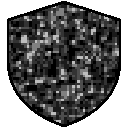
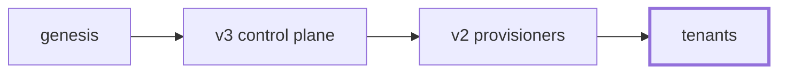
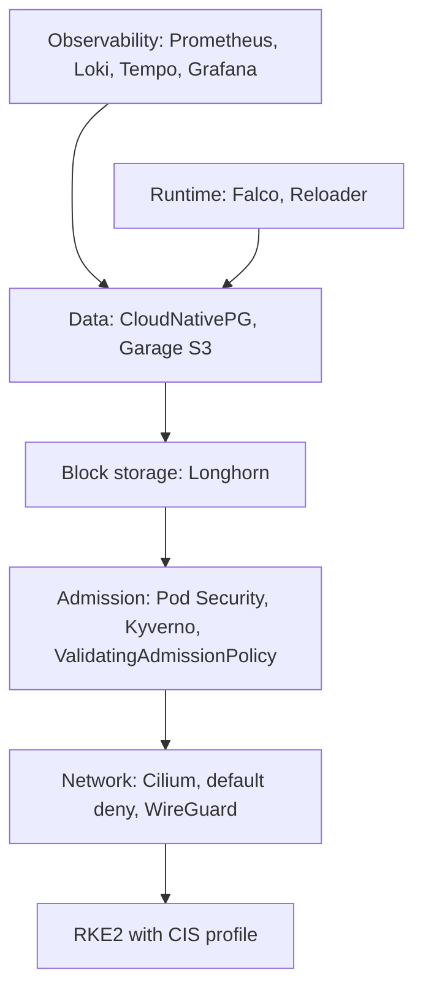

<p align="center">
  
</p>

<h1 align="center">bedrock</h1>

<p align="center">
  Self-hosted Kubernetes platform for managed service providers.<br>
  One hardened cluster per tenant, nothing shared.<br><br>
  <a href="https://bedrock.sassendes.xyz"><b>Documentation</b></a>
</p>

## Why

Most platforms put many customers on one cluster and draw the lines with namespaces. Bedrock doesn't. A tenant is a full cluster with its own nodes, storage, databases, observability, policy and network edge, so one tenant's problem can never become another's. It targets regulated organisations that need to prove isolation, not promise it.

## Architecture



- **Tenant:** the workload cluster. This repository builds it today.
- **v2:** stamps tenants, owns their network edge, rolls upgrades across the fleet. Planned.
- **v3:** places v2s on providers and sites. Planned.
- **Genesis:** the sealed starting point the rest is rebuilt from. Planned.

## The tenant cluster



| Layer | Component |
|---|---|
| Kubernetes | RKE2 with the CIS profile, secrets encryption, audit logging |
| Network | Cilium with kube-proxy replacement, WireGuard encryption between nodes, Hubble |
| Policy | Kyverno, Pod Security Admission, a native ValidatingAdmissionPolicy, registry allowlist |
| Block storage | Longhorn |
| Object storage | Garage, encrypted at rest |
| Databases | CloudNativePG: a primary with synchronous replication, a live replica and a delayed replica, poolers, WAL and base backups to Garage |
| Observability | Prometheus, Alertmanager, Loki, Tempo, Alloy, Grafana, OpenCost, blackbox |
| Runtime | Falco, Reloader |
| Event buses (optional) | NATS JetStream, Redis with Sentinel, Kafka on Strimzi |

## Security posture

- Default deny on every pod in every namespace. Each flow is allowed explicitly and pinned to the exact pods on both sides.
- Nothing reaches the internet. No NodePorts, no LoadBalancers, and cluster DNS has no path outside the cluster.
- Platform services run under the `restricted` Pod Security level. Only the node agents that need the host run privileged, in their own namespace.
- Least-privilege RBAC: no wildcards, no component reading secrets it does not own, replicas read the primary's backups with a read-only key.
- Postgres superuser login is off and every client connection must use TLS.
- Every image is pinned by digest and every upstream bundle is checksum-verified before it is applied.
- kube-bench (`rke2-cis-1.9`): every check passes except one accepted by design (operators need API tokens), plus one not applicable (kube-proxy is replaced by Cilium).

## Repository layout

```
bootstrap/       ansible playbooks, RKE2 and Cilium config, audit policy
platform/        reloader, namespaces, priority classes
netpols/         Cilium network policies, one file per namespace plus the cluster-wide default deny
kyverno/         admission policies
database/        CloudNativePG clusters, poolers, backups
storage/         Garage, bucket initialisation, Longhorn settings
observability/   metrics, logs, traces, dashboards, alerting, falco
event-buses/     NATS, Redis, Kafka
secrets/         placeholder secrets, replaced by OpenBao
docs/            the documentation site
```

## Running it

Requirements: three Debian 12 nodes (4 vCPU, 9 GB RAM, 200 GB disk absolute minimum), SSH key access, and a controller with Ansible.

```sh
sudo ./scripts/ansible_deps.sh
# fill in bootstrap/hosts.ini
make deploy
```

`make teardown` wipes RKE2, etcd and every Longhorn volume on all nodes. It asks you to type `destroy` first.

Dashboards are ClusterIP only. Until the WireGuard edge exists, reach them with `kubectl port-forward`.

The full walkthrough is in the [documentation](https://bedrock.sassendes.xyz/tutorials/first-tenant/).

## Status

The tenant layer runs end to end on a lab cluster. Next: the Go failover operator, OpenBao, then the network edge (OPNsense, WireGuard, nginx), disaster recovery, and the v2 and v3 tiers.

The secrets in `secrets/` are placeholders for a public repository and must never be used as they are.
